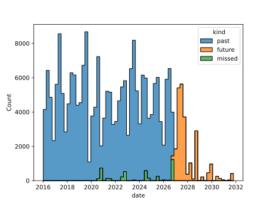

# Allegheny County Weights and Measures Inspections

## Inspection Dashboard

Prepared 2026-11-01  
Data as of 2026-10-31T19:27:28.418292

### Data table

Question: How many devices will need to be inspected during an upcoming time period?

Inspections from 2026-11-01 through 2026-11-08:

|   store_id |   device_count | store_name                    | address                  |
|------------|----------------|-------------------------------|--------------------------|
|      31355 |              2 | AMTRAK                        | 1100 LIBERTY AVE         |
|      40147 |              1 | UHAUL (PROPANE)               | 5 CLAIRTON BLVD          |
|      40551 |              1 | CHANTALS CHEESE SHOP          | 4402 PENN AVE            |
|      40635 |              2 | STEEL GOAT MARKETPLACE        | 200 JEFFERSON RD         |
|      40699 |              1 | WOOF GANG BAKERY              | 6201 SPIRIT ST           |
|      40812 |              2 | MECHANIC COFFEE               | 915 ALLEGHENY RIVER BLVD |
|      40825 |              1 | ARRIVISTE COFFEE ROASTERS     | 5730 ELLSWORTH AVE       |
|      32940 |              2 | UPMC EAST CAFETERIA           | 2775 MOSSIDE             |
|      33111 |              1 | DUNHAM SPORTS                 | 3700 WILLIAM PENN HWY    |
|      40383 |              1 | FARM FRESH FOOD MARKET        | 226 N NEGLEY AVE         |
|      40550 |              1 | BANTHA TEA BAR                | 5002 PENN AVE            |
|      40636 |              4 | TREASURE HUNT                 | 1001 FREEPORT RD         |
|      40814 |             13 | MAITRI GENETICS               | 120 BETA DR              |
|      40815 |              1 | FUZZYS MARKET                 | 426 6TH ST               |
|      41084 |              1 | LEAF &amp; BEAN                   | 2200 PENN AVE            |
|      32563 |              2 | BOOK COUNTRY                  | 3200 WALNUT ST           |
|      40460 |              1 | MERCURIOS                     | 5523 WALNUT ST           |
|      40470 |              3 | TRACTOR SUPPLY                | 122 MOSSIDE BLVD         |
|      40529 |              1 | DYLAMATOS MARKET              | 5414 2ND AVE             |
|      40548 |              1 | SEOUL MART                    | 4701 5TH AVE             |
|      40615 |              1 | SULTAN BEY                    | 4601 CENTRE AVE          |
|      40648 |              1 | DIAMOND &amp; GOLD BUYERS OF PGH  | 1116 FREEPORT RD         |
|      32200 |              2 | PGH FUDGE                     | 355 LINCOLN HWY          |
|      40799 |              1 | CARRIBEAN TASTE GROCERY STORE | 1572 MONTIER ST          |
|      40823 |              1 | MERCURIO&#39;S                    | 1335 FREEPORT RD         |
|      41224 |              5 | ALDI                          | 2515 BANKSVILLE RD       |

Total stores: 26  
Total devices: 53

Timeline of inspection history:

### Methodology

This dashboard is based on the following inputs:

1. The device's latest inspection date
2. The device's stated inspection cycle (12, 36, or 60 months)
3. The device is not marked as deleted, the device's store is not marked as out of business, and the device's store refers to a row that exists.

This ignores the following concerns (at least):

- If the latest inspection is a Fail, it should probably be reinspected as soon as possible, not 12 months from now.
- In real life, the inspection sticker has a year and month on it, so for correctness the time interval should be rounded up or something.
- Deciding that a device ought to have been reinspected at some point in the past is only a guess if the device is still active. If the device is inactive _now_, it may or may not have missed a reinspection but there's no way to answer that. Just ignore these then.

## Answers to questions

### Explain how you'd handle the dataset being updated

The data processing is completely stateless, and always produces a clean output each time. Updates to the dataset require two considerations: First of properly fetching the data, and second of integrating with derived state.

To properly fetch the data, I note that the CKAN API describes a package's resource as having a revision id, but either ignores the meaning of this or relies on the data dump webserver to implement it. The WPRDC data dumps are served from a fixed URL without any HTTP headers such as ETag or Last-Modified to indicate changes.

As for derived state, this simple demo has none, but it could for instance integrate with a task or assignment system that records the actual field work. Depending on the nature of a particular entity, it should either be treated as entirely read-only, or an editable copy should be made if it is possible that the upstream data could change in unclean ways. For instance, the Store entity could always be overwritten, while a Device's date of last inspection would be something we would want to copy, as we would anticipate making decisions based on its verified value.

### What you'd do differently at 100x scale

In short: Either switch from the full CSV dumps to the queryable API and request a window of data, or redefine the dump format to be partitioned by date. (Or, of course, use the nice PostgreSQL server that the data comes from in the first place.)

The Air Quality data is a good example of this: It contains nearly 11 years of data averaging 3,000 points per hour. This 1,096 MiB CSV file is sort of unwieldy. Conversion to Parquet using Zstd compression makes it much easier to handle: Each row group contains around 100k rows, and data sorted by time is naturally easy to partition. Row statistics, bloom filters, and dictionaries make it possible to filter on the varied column types in this file.

### Data quality checks

The Weights and Measures Inspections data is mainly plagued by inconsistent formatting of free text fields: `DUNCAN INSUTRIES`, Pittsburgh, PITTSBURGH, unknown, `DOWNTOWN (CENTRAL BU`, and so on. Thankfully these are mostly uninteresting, although grouping by `PGH INTERNATIONAL AIRPORT` vs `PITTSBURGH INTERNATIONAL AIRPORT` would fail.

When a Store has `oob=True`, in many cases devices are _not_ set to `deleted=True`, which raises questions as to the possible states of this data. The device's `remarks` field occasionally contains concerning notes, such as `REJECTED` but apparently for a device in service. Perhaps the remarks belong on the Inspection entity.

Inspection having a granularity of a whole day is problematic when a single device encounters more than one inspection in a day, particularly with differing results. Was it Fail then Pass? Or Pass then Fail?

### Other Surprises

Some stores contain no devices, which is perhaps sensible. Some devices reference a store_id that doesn't exist. Some devices have never been inspected, or were inspected ten years ago for a 12 month cycle. Again, there's no obvious way to tell if this is bad data (forgot to delete the devices) or bad reality.

The graph shows that in early 2020, a substantial fraction of inspections missed their deadline.

The most devices inspected in a single store in a single day is PGH PARKING AUTHORITY: 1,350 devices on 2019-07-30.

### Possible questions

What's the failure rate of various categories of devices?

Is there any bias in the frequency of inspections? Should there be? Regarding locality/neighborhood, device make/model, etc.

How many inspections are there per store per device per year?

### AI Disclosure

Tools used: Google AI Overviews  
Purpose: You can type all kinds of nonsense into the search box and it'll somehow emit ten blue links that match what you're looking for. It even correctly ignores me when I typo "pandas" for "polars" but the rest of my query unambiguously describes a Polars problem.

But be careful! Sometimes it spits out randomly generated Python code, which may or may not solve any problem which may or may not be the problem you actually have. I asked it to convert CSV to Parquet with PyArrow and it wrote one row group for each chunk of CSV input from the scanner, producing a uselessly fragmented file.

As it happens, you can probably customize the batch size with the csv.ReadOptions, but I chose to use a library with more convenient defaults for me. DuckDB was annoyingly strict regarding the extra `CR` byte in the CSV header line; Polars did exactly what I needed (`pl.scan_csv(…).sink_parquet(…)`) without any complaints.